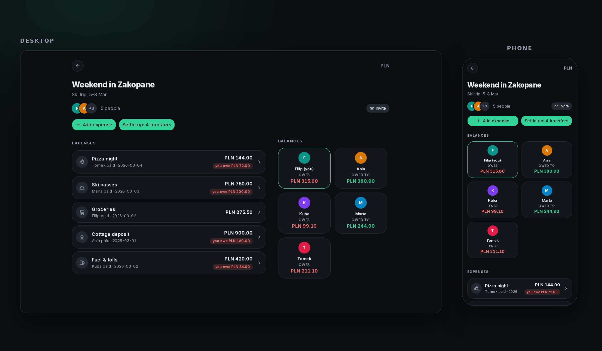

<div align="center">
  
</div>

<br>

<div align="center">
  
  
  
  
  
  
  
  
  
</div>

---

<div align="center">
  <a href="https://evencost-ivory.vercel.app">
    
  </a>
  <br>
  <i>(Note: This is a live preview deployment and may be taken down or disabled at any time.)</i>
</div>

---



---

**EvenCost** is a small web app for **splitting shared costs** in a group. Use it
for a trip, a flat, a project, or the place you share every month. Everyone adds
what they paid, and the balances stay current without a spreadsheet.

Each expense is split **equally**, by **exact amounts**, or by **percentage**.
The arithmetic is **exact to the cent**, so the parts always add up to the total,
and deleted expenses stay in the history.

When it is time to close the books, EvenCost suggests an **optimized set of
transfers** that clears the whole group. Record the **full settle-up** or a
**partial payment**, and everyone can see who owes whom. No spreadsheets, no
mental arithmetic, and no chasing people for small amounts.

## 📖 Table of contents

- [What it does](#what-it-does)
- [Stack](#stack)
- [How it's built](#how-its-built)
- [Run it locally](#run-it-locally)
- [Run it on a host](#run-it-on-a-host)
- [Infrastructure](#infrastructure)
- [Documentation](#documentation)
- [License](#license)

## ✨ What it does

1. **Create a group.** A name, a description, one currency
2. **Invite people** with a single link; they sign up and land straight in
3. **Add expenses.** Who paid, how much, and how to split it: equally, by exact
   amounts, or by percentage
4. **Watch the balances** update as expenses land
5. **Settle up.** EvenCost suggests an optimized set of transfers that clears
   the whole group, or you record a partial payment instead
6. **Everyone at zero.** Done

Settlement is a recorded transfer, not a checkbox, so paying back half of what
you owe works properly.

**Dark by default, built phone-first. But not phone-only.** On a phone it is a
back arrow, bottom sheets and thumb-sized actions, made for the end of the trip.
Open it on a laptop and it becomes a two-column layout: expenses on the left,
balances and people on the right.

## 🧱 Stack

| Layer | Technology |
| :--- | :--- |
| Frontend | Next.js 16 (App Router), Tailwind CSS 4, shadcn/ui |
| Backend | Server Actions + Route Handlers |
| Database | PostgreSQL 17. Local to the dev container, any hosted Postgres in production |
| ORM | Drizzle |
| Auth | Better Auth |
| Dev environment | Dev Container (VS Code) |

At runtime the app uses one database URL; migrations use a second, direct one.
Swapping the local Postgres for a hosted one (Neon, Supabase) is a config
change. Not a code change.

## 🔧 How it's built

Not a feature list. Each line is something you can check in the code, with the
file that proves it.

| Claim | Proof |
| :--- | :--- |
| **Business rules know nothing about the framework** | Splits, balances, netting and permissions are plain TypeScript with no Next.js, React or database imports. [src/domain/](src/domain/) |
| **Every action authorizes itself** | A Server Action is a public POST endpoint, so each one checks the session, validates its input and re-checks ownership. Hiding a button is never the boundary. [groups/actions.ts](<src/app/(app)/groups/actions.ts>) |
| **Money is never a float** | Integer minor units everywhere; the form and the server run the same split function, and the server re-checks the sum before storing. [splits.ts](src/domain/splits.ts) |
| **Deletes are soft** | Expenses, memberships, settlements and groups are marked, never removed, so history and balances stay correct. [schema.ts](src/db/schema.ts) |
| **Tests run the real arithmetic** | Property tests over random amounts and party sizes, plus an integration test that races two settle-ups against a real Postgres. [src/domain/](src/domain/) · [settle.test.ts](src/lib/settle.test.ts) |
| **Dark, tabular, colour-blind safe** | Amounts use tabular figures, and green/red always comes with a sign and a word, never colour alone. [globals.css](src/app/globals.css) |
| **One codebase, two environments** | Local container and host differ only in environment variables; there is no "am I deployed" branch anywhere. |

## 🚀 Run it locally

Everything runs inside the dev container; nothing is installed on your machine.

1. **Create the env files.** Both are gitignored, so a fresh clone has neither:

   ```bash
   cp .env.example .env
   cp .devcontainer/.env.example .devcontainer/.env
   ```

   Fill in the values. `.devcontainer/.env` is required before the container can
   start; `.env` is what the app and the migrations read. The example files say
   what goes where, and [Dev environment](docs/dev-environment.md#two-env-files)
   explains why.

2. **Open the repo in the container.** In VS Code, run *Dev Containers: Reopen in
   Container*. On first creation this installs PostgreSQL 17, starts the
   cluster, creates the local `evencost` role and database, runs `npm install`
   and applies the migrations.

3. **(Optional) Seed demo data.** `npm run db:seed` fills the database with two
   demo groups to click through. Skip it to start empty. Sign in with
   `filip@evencost.test` / `devpassword`. The database lives in the container
   layer, so it is wiped on every rebuild. Re-run the seed to get it back.

4. **Start the dev server.** `npm run dev`, then open
   [http://localhost:3000](http://localhost:3000).

Dependencies are installed on create, and migrations run on create and on every
start. Neither is a step you run by hand once the env files exist. If the
container was created before `.env` existed, run `npm run db:migrate` once.

## ☁️ Run it on a host

The same app and the same code. Only the environment changes, and no code is
commented out for one or the other.

1. **Get a Postgres.** Any host works (Neon, Supabase, a VPS). Copy **two**
   connection strings: the pooled one and the direct one.

2. **Create the project** on your host and point it at this repository.

3. **Set five variables** in the host's dashboard:

   | Variable | What it is |
   | :--- | :--- |
   | `DATABASE_URL` | the **pooled** string. Serverless opens a connection per instance, so the direct one exhausts Postgres. |
   | `DIRECT_URL` | the **direct** string. Migrations only: a transaction-mode pooler cannot run them. |
   | `BETTER_AUTH_SECRET` | 32+ characters of entropy. `openssl rand -base64 32`. |
   | `BETTER_AUTH_URL` | the public URL of the deployment. |
   | `NEXT_SERVER_ACTIONS_ENCRYPTION_KEY` | `openssl rand -base64 32`. Required once more than one instance serves traffic. |

4. **Deploy.** The build command applies migrations before building, so there is
   no separate step and nothing to run by hand.

**One caveat worth knowing:** sign-in throttling counts per process, which on a
serverless host protects nothing. A shared Upstash store is not built yet, so
production sign-in is effectively unthrottled until it is.

## 🌐 Infrastructure

The live preview is deployed using the following cloud services:

| Component | Provider | Details |
| :--- | :--- | :--- |
| **Application** | [Vercel](https://vercel.com) | Next.js serverless hosting, Server Actions, CI/CD from `main` |
| **Database** | [Neon](https://neon.tech) | Serverless PostgreSQL 17 (AWS Frankfurt `eu-central-1`) |
| **DNS & Domain** | [Cloudflare](https://cloudflare.com) | Domain management, DNS, SSL/TLS |
| **Source Code** | [GitHub](https://github.com) | Repository and version control |

## 📚 Documentation

Anything that isn't in this file lives in [`docs/`](docs/).

## 📄 License

Released under the [MIT License](LICENSE).
