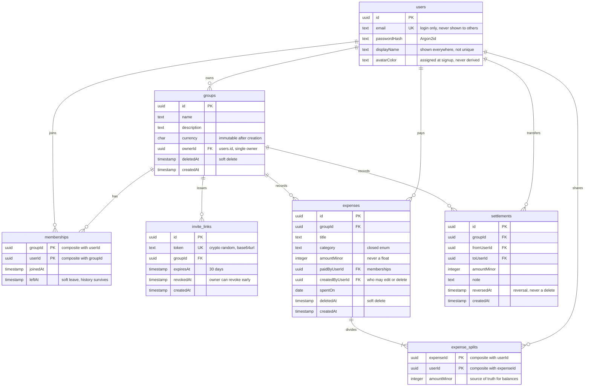

# EvenCost data model

The seven tables and how they relate. The Drizzle schema is the source of truth
for columns; this file exists for the one thing it does not show at a glance,
which is the shape of the relations. Rendered by GitHub and by the VS Code
Markdown preview.

## The four columns that carry behaviour

Everything else is ordinary. These are the ones a reader would otherwise have to
infer from the code.

| Column | What it means |
| :--- | :--- |
| `users.avatarColor` | Stored, not derived. Computed from a list index it would repaint everyone when the list changes (rule 8b). |
| `expenses.createdByUserId` | Ownership of an expense is the creator, never the payer. The payer has no edit rights (rule 8a). |
| `*.deletedAt` / `*.leftAt` / `*.reversedAt` | Nothing that carries history is ever hard-deleted (decision 4). |
| `groups.currency` | No edit path at all, so there is no migration case for changing it (decision 5). |

## What the diagram does not show

- **Balances are not stored.** They are computed from expenses minus un-reversed
  settlements on every read, which is why there is no `balances` table and why a
  concurrent settle-up needs a row lock on the group (rule 14).
- **`expense_splits` must sum to `expenses.amountMinor`.** PostgreSQL cannot
  enforce that across tables, so it is checked in the domain and again inside the
  transaction (rule 9).
